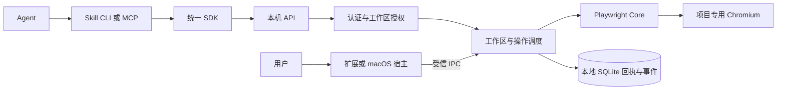

# open-browser 总体架构

open-browser 是一个本机运行的 Agent 浏览器。它使用项目专用 Chromium 资料，CLI、SDK 和 MCP 共享同一套 API，由本机服务统一管理工作区、页面、权限、操作回执和人工接管。

## 运行链路

## 组件职责

| 组件 | 职责 |
| --- | --- |
| CLI、SDK、MCP | 解析调用、连接本机 API、统一错误和回执格式 |
| 本机服务 | 认证调用方，维护工作区和页面状态，执行权限检查、调度、幂等和恢复 |
| 工作区 | 绑定 Agent 名称、任务名、资料、站点来源、页面和控制代次 |
| Playwright Core | 执行页面观察、定位、等待、输入、下载和弹窗处理 |
| Chromium 扩展 | 管理标签组、标签操作入口、新标签页控制台和人工接管按钮 |
| macOS 宿主 | 提供原生窗口、前景悬浮栏、资料隔离和受信控制通道 |
| 回执存储 | 保存脱敏操作回执、事件游标和交付物索引，默认保留七天 |

## 工作区与权限

- 每个工作区拥有独立的页面集合、来源集合、控制代次和操作队列。
- 同一页面的写操作按顺序执行，不同工作区可以并发执行。默认全局并发为四，可按内存水位降低。
- `read` 只允许读取工作区状态、事件、下载和只读观察。`control` 才能提交页面动作。
- 页面导航、被动资源、凭据、像素截图分别授权。观察结果会遮盖已绑定凭据和常见令牌格式。
- 用户接管会撤销当前 Agent 控制代次。Agent 交回后必须重新观察页面，旧引用自动失效。

## 操作与恢复

Agent 按 `observe → act → getOperation → observe` 推进任务。每个写操作带唯一 `operationId`，相同请求返回原回执，参数不同返回冲突。服务重启会把进行中的回执标记为待核实，调用方需要先核对网站结果再决定是否继续。

任务完成时调用 `finishWorkspace`。服务等待在途操作收束，撤销任务标签组，关闭临时页，并把用户选中的结果页保留为普通标签。下载交付物留在本机资料目录，Agent 通过分块 `readOutput` 读取。

## 隐私边界

默认使用专用 Chromium 资料，与系统 Chrome 目录隔离。默认严格网络模式只允许工作区已授权来源，静态资源可以使用无 Cookie 的匿名请求上下文。CLI、SDK、MCP 只通过本机 Unix socket 或 Windows 命名管道访问服务。项目不包含产品遥测，详细范围见[隐私与开源审计](open-browser隐私与开源审计.md)。

## 代码入口

- 服务与调度 [engine-service.mjs](../engine-service.mjs)、[scheduler.mjs](../scheduler.mjs)
- 页面观察 [page-observation.mjs](../page-observation.mjs)
- 权限注册 [access-registry.mjs](../access-registry.mjs)
- 扩展宿主 [chromium-host.mjs](../chromium-host.mjs)、[browser-extension/worker.js](../browser-extension/worker.js)
- API 类型 [open-browser-api.d.ts](open-browser-api.d.ts)
- 发行与平台 [跨平台试用与发行](跨平台试用与发行.md)
