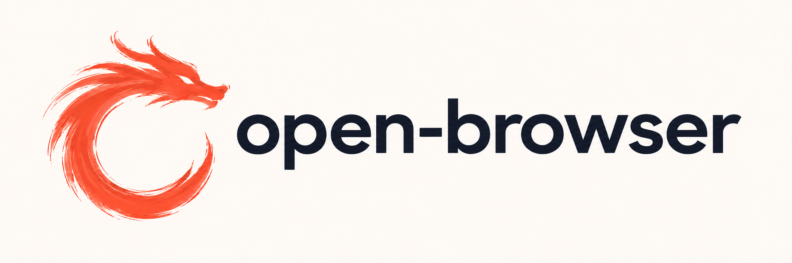
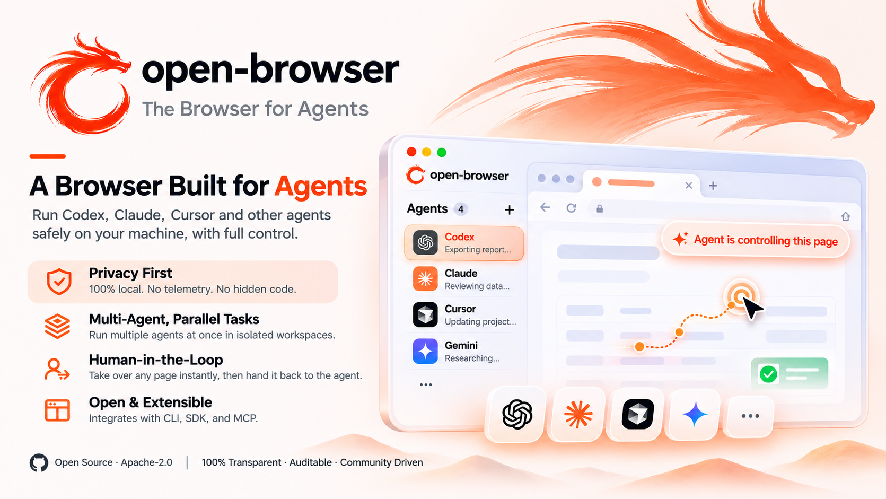

<h1 align="center"></h1>

<p align="center"><strong>English</strong> · <a href="README.zh-CN.md">简体中文</a></p>

**Run several agents in background tabs and take over the exact page when a task needs you.**

open-browser is an open-source desktop browser for agents. It runs locally and ships with its own Chromium. One agent can sign in and export a report while another checks a form and you keep working in the foreground. The sidebar groups tabs by agent and task. When the task finishes, you choose which result tabs to keep.

[Quick start](#quick-start) · [Try a handoff](#try-a-handoff) · [SDK, CLI and MCP](#sdk-cli-and-mcp) · [Architecture](Docs/Agent浏览器总体架构.md) · [Privacy](Docs/open-browser隐私与开源审计.md) · [Contributing](CONTRIBUTING.md) · [Links](#links)



## What you can do

- **Run tasks in parallel.** Workspaces progress independently and actions on each page stay in order. The service keeps same-page actions ordered while independent workspaces run concurrently. Use `npm run test:unit` and `npm run test:contract` to reproduce the local regression suites.
- **Use an existing signed-in tab.** Ask the agent to create a named workspace. Open the extension on the desired open-browser tab, choose that task, and pass the two-minute authorization to the agent. The tab stays open when the task finishes.
- **Share a live task with an agent.** Take over during sign-in, complete the form in place and hand the same tab back with its session intact. For routine sign-ins, bind a credential to the workspace and site so the agent can fill it by reference. [Workspace and handoff guide](Docs/控制台分组与接管方案.md)
- **Keep Agent input visibly exclusive.** While a workspace is in Agent control, the managed page rejects human page input and shows the existing task border and action cursor. Each Agent action opens a scoped dispatch window, then the page locks again. Use **人工接管** to edit the page yourself and **交回 Agent** to resume.
- **Pause safely for site verification.** When a site returns a recognized security challenge, the workspace stops Agent actions and shows **需要人工验证**. Take over the visible page, complete the site's own verification, then return control and observe again. open-browser does not hide automation signals or bypass the challenge.
- **See the work without another dashboard window.** Every new tab opens the local Agent console with active workspaces, agent names, current status and recent operation records. The native task bar keeps only takeover and a one-click **End** action.
- **Delegate only the access a task needs.** Grant read access to an agent that checks results and control access to one that fills forms. Managed tabs have a list of permitted origins. Reading screenshots requires a separate pixel grant. [API types](Docs/open-browser-api.d.ts)
- **Find out what happened after a disconnect.** The local service keeps the workspace alive when the CLI exits. Look up the receipt by operation ID. If submission is uncertain, check the site's result before retrying. [Evaluation guide](Docs/open-browser任务评测指南.md)
- **Read delivered results in bounded chunks.** A kept download receives a local manifest and can be read through `readOutput` in 64 KiB chunks. The manifest expires after 24 hours and stays on the local machine.

## Quick start

From the repository root, install the dependencies and dedicated Chromium with Node.js 22.23.5 or later. The first engine installation requires internet access.

```sh
npm ci
npm run browser:install
```

To try the control API, run the integration test. It starts a temporary local service and test site, creates a workspace through the CLI and reads the same page through MCP.

```sh
node --test service.integration.test.mjs
```

To open the stable desktop browser, run `npm start`. Use `npm run start:dev` for an isolated development build with separate state, PID, socket, receipts and macOS app identity. The first macOS desktop build requires Xcode command line tools and a Developer ID Application certificate. If you already have a build, open `dist/open-browser.app`. For public GitHub DMG and ZIP releases, set a notarytool profile or CI credentials and run `npm run build:release-macos:arm64` or `npm run build:release-macos:x64`, then run `npm run release:verify-macos`. Windows and Linux support running from source and x64 portable builds. For a headless service, run `node service.mjs --headless`. [Platform prerequisites and packaging](Docs/跨平台试用与发行.md)

## Try a handoff

1. Use the CLI or SDK to open a local test page that requires a credential. The task appears in the browser's native Agent group and in the new-tab console.
2. Select the waiting page and choose **人工接管** in the bottom bar or extension. Complete the form in the original tab, then choose **交回 Agent**.
3. The Agent observes the current document again and continues with the existing session. The one-click **结束** action closes the active task group while keeping any result tabs you selected.

## Privacy and accounts

- open-browser uses a dedicated profile separate from personal Chrome. Ordinary desktop tabs and workspaces in the same profile can share same-site cookies. Use separate `OPEN_BROWSER_PROFILE` values for separate accounts.
- The default `strict` configuration reduces Chromium background services. A managed workspace uses the first site's origin by default. Specify `allowedOrigins` for other task sites and `resourceOrigins` for resources such as images or fonts. Ordinary tabs follow Chromium's own network settings.
- Site credentials are kept in service memory and scoped to a workspace and origin. Observations redact bound credentials and common token formats. Visible business data may still reach the agent. The client controls what it forwards to its model.
- The default configuration includes no product telemetry, ad scripts or remote account service. Inspect the running configuration with `node cli.mjs capabilities` and use `node benchmarks/privacy-audit.mjs` to inspect a loopback task. Chromium may contact built-in services during startup. [Privacy and open-source audit](Docs/open-browser隐私与开源审计.md)

## SDK, CLI and MCP

The CLI and MCP server use the same SDK to call the local API. The service drives Chromium through Playwright Core and shares page state, permissions and operation receipts across clients.
Every new workspace must include a clear `name` task label. The label appears in the Agent console, native sidebar and browser tab group.

The scoped npm package exposes the same implementation through separate entry points. Install it with `npm install @seekskyworld/open-browser`. Run `open-browser` for CLI calls, configure `open-browser-mcp` as an MCP stdio server, or run `open-browser-mcp-http` for an authenticated loopback MCP endpoint. JavaScript clients can import `OpenBrowserClient` from `@seekskyworld/open-browser`.

Agents using the [open-browser Skill](skills/open-browser/SKILL.md) call the CLI through `skills/open-browser/scripts/open-browser`. The Skill starts the local open-browser app or portable service when needed and retries once after it becomes ready. Set `OPEN_BROWSER_AUTOSTART=0` to require an already running service. Start the app manually or run `npm start` when you want to open the desktop window before creating a task. Pass method arguments as JSON on standard input. Use `node cli.mjs --help` to list methods. Run `open-browser skill` to print the platform-matched guide without starting the service.

The optional `open-browser-mcp-http` command binds only to loopback, uses the profile token as Bearer authentication, and serves `/mcp` for clients that require URL-based MCP configuration. Set `OPEN_BROWSER_MCP_HTTP_PORT` to choose a port.

On the first Skill or service start, open-browser detects existing Skill directories for Codex, Claude Code, Cursor, Windsurf, Gemini CLI, Cline, Roo Code and OpenCode. It creates an `open-browser` relative symlink in each detected directory, preserving existing files and links. Windsurf's standard `~/.codeium/windsurf/skills` directory and its legacy `~/.windsurf/skills` directory are both supported. Set `OPEN_BROWSER_AUTO_INSTALL_SKILLS=0` to disable this behavior. Add agent-specific Skill directories with the `OPEN_BROWSER_AGENT_SKILL_DIRS` path-list variable.

For one explicit URL, an agent can use one `open` call to create a workspace and open the page. This shortcut keeps Chromium's normal page network so cross-origin CSS, scripts, fonts and images render normally. Observation and actions remain bound to the target workspace and origin. Use `createWorkspace` when strict origin isolation is required.

```sh
printf '%s\n' '{"url":"https://example.org","name":"Page check"}' | node cli.mjs open
```

The SDK also provides `openAndObserve(options)`, `observeAndAct(page, { actions })`, `actAfterObserve(page, { actions })` and `finish(workspaceId, keepPageIds)`. Observation and action submission can use one service request while preserving fresh document IDs, control generations, workspace permissions and idempotent operation receipts.

For continuous tasks, run `open-browser session` and send one JSON request per line with `id`, `method` and `params`. The session reuses one Node client and local connection to avoid process startup on every action.

For multi-step work, use the full SDK lifecycle.

```sh
node --input-type=module <<'JS'
import { OpenBrowserClient } from './sdk.mjs';
const api = new OpenBrowserClient();
const { workspaceId } = await api.createWorkspace({ name: 'SDK example' });
try {
  const page = await api.openPage(workspaceId, 'https://example.org');
  console.log((await api.observe(page)).text);
} finally {
  await api.closeWorkspace(workspaceId);
}
JS
```

MCP uses stdio. The example below assumes the app is installed in `/Applications`. Replace both paths with the absolute path to a local build when needed.

```json
{
  "mcpServers": {
    "open-browser": {
      "command": "/Applications/open-browser.app/Contents/Resources/node/bin/node",
      "args": ["/Applications/open-browser.app/Contents/Resources/app/mcp.mjs"]
    }
  }
}
```

Client tokens live under `~/.open-browser/`. Clients connect over a Unix socket or a Windows named pipe. Results handed to an external agent are processed according to that client’s model provider. Managed tabs restrict WebSockets, workers and scripted popups. Third-party sign-ins may require a handoff. [API types](Docs/open-browser-api.d.ts) · [Architecture](Docs/Agent浏览器总体架构.md)

<details>
<summary>Existing profiles, macOS Keychain and privacy settings</summary>

The default desktop profile lives at `~/.open-browser/open-browser-profile-v2/` on macOS and `~/.open-browser/open-browser-profile/` on Windows and Linux. Site-data encryption uses the system Keychain item named `open-browser Keychain`. Builders can select a signing identity with `OPEN_BROWSER_SIGN_IDENTITY`. macOS release credentials are read from `OPEN_BROWSER_NOTARY_PROFILE` or CI-provided API Key and Apple ID variables. [Build check](desktop/brand-keychain.py)

</details>

## Results, profiles and client permissions

Use the **End** control in the floating bar or the extension's workspace panel when the task is complete. The service preserves the current document and its form state while keeping selected result tabs. Its existing sandbox remains in effect until the next navigation. Agents call `finishWorkspace` once the task is complete. Tab selection and individual actions leave the task group active. Receipt history remains available after restart. Chromium's session settings determine which tabs reopen.

To use two accounts concurrently, run each command in its own terminal and use the matching profile name in its clients. Names support up to 48 lowercase letters, digits, underscores and hyphens.

```sh
OPEN_BROWSER_PROFILE=work node service.mjs --chromium
OPEN_BROWSER_PROFILE=personal node service.mjs --chromium
```

A local administrator can pair a client and give it the resulting token file. Replace the placeholder IDs below with the paired principal and target workspace. Processes with file access under the same OS account can read each other's tokens. Use separate OS accounts when that boundary matters.

```sh
printf '%s\n' '{"name":"Reviewer","tokenFile":"/tmp/open-browser-reviewer.token"}' | node cli.mjs admin.pair
OPEN_BROWSER_CLIENT_TOKEN_FILE=/tmp/open-browser-reviewer.token node cli.mjs listWorkspaces
printf '%s\n' '{"principalId":"CLIENT_ID","workspaceId":"WORKSPACE_ID","permission":"read"}' | node cli.mjs admin.grant
printf '%s\n' '{"principalId":"CLIENT_ID","workspaceId":"WORKSPACE_ID"}' | node cli.mjs admin.revoke
```

A `read` grant permits observation. A `control` grant also permits actions. Revoking delegated control hands an active task back to the user. List paired clients with `admin.list` or invalidate a token with `admin.revokeClient`. Receipts and events have a seven-day retention period. Use `admin.clearHistory` with a finished workspace ID to clear its history and grants. Use `listEvents` to export diagnostic events by cursor.

The workspace panel can grant an origin for the current task after a blocked request. Permission for a passive resource and permission to navigate to its origin are separate. After granting navigation, retry the original action. [Agent Skill](skills/open-browser/SKILL.md)

### Scheduling and permissions

Inspect active slots, queue depth and cumulative wait and execution time with `node cli.mjs admin.scheduler`. The default concurrency is four. The service admits up to 128 in-flight requests per workspace and 512 in total. Configure `OPEN_BROWSER_LOW_MEMORY_MIB` to reduce concurrency under memory pressure or set it to zero for a fixed limit.

The Skill covers masked screenshots and spatial input. [Agent Skill](skills/open-browser/SKILL.md) · [Hosted deployment](hosted/README.md)

## Contributing

A useful first contribution is a reproducible page fixture. For example, put a Save button on each of two order rows, ask the agent to edit one order and check which row the site actually received. Existing tests cover duplicate controls, file uploads, sign-in and handoff. [Contributor guide](CONTRIBUTING.md) · [Evaluation guide](Docs/open-browser任务评测指南.md)

Run `npm run test:unit` for the fast local suite and `npm run test:all` before merging. Run `npm run build:verify` to validate versions and produce a desktop build. `npm run clean` removes generated `dist` and local engine caches. Report security and privacy issues privately. [Security policy](SECURITY.md)

open-browser code is licensed under Apache 2.0. Bundled Chromium, Node.js and other components carry their respective licenses. [License](LICENSE) · [Third-party notices](Docs/THIRD-PARTY-NOTICES.md)

## Links

<a href="Docs/assets/open-browser-logo.png"></a>

- [Linux DO community](https://linux.do/)
- [Workspace architecture](Docs/Agent浏览器总体架构.md) · [Privacy audit](Docs/open-browser隐私与开源审计.md)
- Download the [dragon icon](Docs/assets/open-browser-logo.png) or the [horizontal wordmark](Docs/assets/open-browser-wordmark.png).
