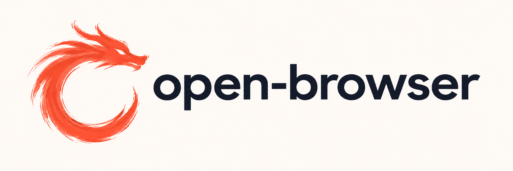
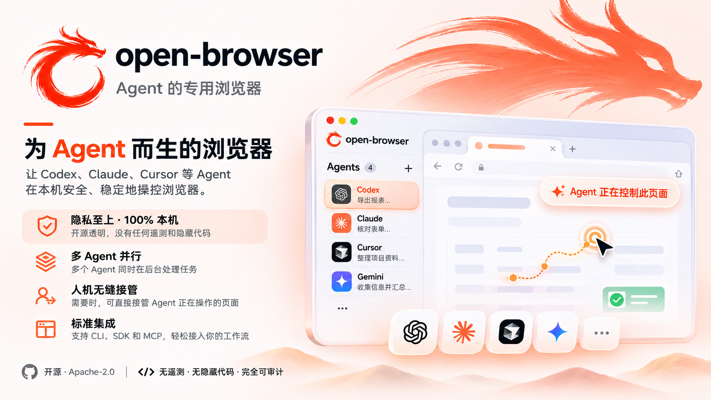

<h1 align="center"></h1>

<p align="center"><a href="README.md">English</a> · <strong>简体中文</strong></p>

**让多个 Agent 在浏览器后台各做各的任务，需要时，你可以直接接管它正在操作的那一页。**

open-browser 是一个本机运行的开源 Agent 浏览器，自带 Chromium。你可以让一个 Agent 登录后台导出报表，让另一个在不同标签里核对表单，同时继续使用前台标签。左侧按「Agent 名称 · 任务名」分组，任务结束后，选中的结果页留在浏览器里。

[快速开始](#快速开始) · [试一次人工接管](#试一次人工接管) · [接入 CLI、SDK 或 MCP](#sdkcli-与-mcp) · [总体架构](Docs/Agent浏览器总体架构.md) · [隐私审计](Docs/open-browser隐私与开源审计.md) · [贡献指南](CONTRIBUTING.md) · [相关链接](#相关链接)



## 用它做什么

- **后台并行处理网页。** 不同工作区可以同时推进，同一页的动作按顺序执行。服务保证同页动作按顺序执行，同时允许不同工作区并发。可运行 `npm run test:unit` 和 `npm run test:contract` 重现本机回归套件。
- **人和 Agent 接力完成任务。** 登录需要你确认时，接管原标签就能继续操作，保留当前表单和登录态。交回后，Agent 重新观察页面再继续。你也可以预先为指定站点绑定凭据，让常规登录自动完成。[工作区与接管](Docs/控制台分组与接管方案.md)
- **新标签页就是任务控制台。** 每个新标签页只显示正在运行的 Agent 和运行历史，包含 Agent 名称、任务状态、最近步骤和时间。页面底部悬浮栏只保留人工接管和一键「结束」，结束时保留现有页面并撤销任务分组，不再弹出交付窗口。
- **给 Agent 刚好够用的权限。** 给核对结果的助手授予只读权限，给填写表单的助手授予控制权限。受管页面按任务授权访问站点，读取截图还需要单独的像素授权。[接口与权限](Docs/open-browser-api.d.ts)
- **断线后查清上一步。** CLI 进程退出后，工作区由本机服务继续管理。连接恢复时，可以凭操作 ID 查询回执。遇到提交结果未知的情况，先核对站点，避免把同一张表单再交一次。[任务评测指南](Docs/open-browser任务评测指南.md)
- **分块读取交付结果。** 用户保留下载后会生成本地 manifest，Agent 可以用 `readOutput` 按 64 KiB 分块读取。manifest 24 小时后过期，数据保留在本机。

## 快速开始

在仓库根目录使用 Node.js 22.23.5 或更新版本安装依赖和项目专用的 Chromium。首次安装需要联网。

```sh
npm ci
npm run browser:install
```

**先试控制接口**，运行下面的用例。它启动临时本机服务与测试站，通过 CLI 创建工作区，再由 MCP 读取同一页。测试使用临时资料，你可以直接看到通过或失败的结果。

```sh
node --test service.integration.test.mjs
```

**打开桌面浏览器**，运行 `npm start`。macOS 首次启动会构建签名应用，需要 Xcode 命令行工具和 Developer ID Application 证书。已有构建时可直接打开 `dist/open-browser.app`，当前构建尚未公证。Windows、Linux 支持从源码启动和 x64 便携包。仅需无头服务时运行 `node service.mjs --headless`。[各平台构建、系统依赖与校验](Docs/跨平台试用与发行.md)

## 试一次人工接管

1. 使用 CLI 或 SDK 打开一个需要凭据的本机测试页。任务会出现在浏览器原生 Agent 分组和新标签页控制台中。
2. 选中等待中的标签，点击页面底部或扩展里的 **人工接管**。直接在原页完成表单，再点击 **交回 Agent**。
3. Agent 会重新观察当前文档并沿用现有登录态继续执行。点击一次 **结束** 可收起活动任务组，同时保留选中的结果标签。

## 隐私与账号

- 浏览器使用 open-browser 自有资料，与个人 Chrome 隔离。同一份桌面资料下，普通标签和工作区可以共享同站 Cookie。需要分开两个账号时，用 `OPEN_BROWSER_PROFILE` 分别启动两份资料。
- 默认 `strict` 配置限制 Chromium 的后台服务。受管页默认以首次打开的站点为访问范围，也可以用 `allowedOrigins` 指定站点，用 `resourceOrigins` 单独授权图片、字体等资源。普通标签使用 Chromium 自身的网络设置。
- 站点凭据按工作区和来源保存在服务内存中。观察结果会遮盖已绑定的凭据和常见令牌格式。网页正文仍可能包含业务信息，外部 Agent 是否把观察结果发送给模型由其客户端决定。
- 默认配置不启用产品遥测、广告脚本或远程账号服务。可用 `node cli.mjs capabilities` 查看实际配置，用 `node benchmarks/privacy-audit.mjs` 在本机复核回环任务的连接。Chromium 自身可能在启动阶段访问内置服务，详见[隐私与开源审计](Docs/open-browser隐私与开源审计.md)。

## SDK、CLI 与 MCP

CLI 和 MCP 都通过同一个 SDK 调用本机 API。服务端使用 Playwright Core 驱动专用 Chromium，并在各入口之间共享页面、权限和操作回执。
每个新工作区都必须填写清晰的 `name` 任务名称，该名称会显示在 Agent 控制台、原生侧栏和浏览器标签组中。

Scoped npm 包提供同一套实现的三个入口。运行 `npm install @seekskyworld/open-browser` 后，使用 `open-browser` 调用 CLI，使用 `open-browser-mcp` 配置 MCP stdio 服务，使用 `open-browser-skill` 作为 Agent Skill 命令。JavaScript 客户端可以从 `@seekskyworld/open-browser` 导入 `OpenBrowserClient`。

Agent 使用 [open-browser Skill](skills/open-browser/SKILL.md) 时，通过 `skills/open-browser/scripts/open-browser` 调用 CLI。Skill 会在需要时启动本机 open-browser 应用或便携服务，等待就绪后自动重试一次。设置 `OPEN_BROWSER_AUTOSTART=0` 可要求服务必须已运行。希望先打开桌面窗口时，也可以手动启动应用或执行 `npm start`。

先打开应用或执行 `npm start`。在项目根目录运行 `node cli.mjs createWorkspace` 创建工作区，运行 `node cli.mjs listWorkspaces` 查看结果。带参数的命令通过标准输入传入 JSON。`node cli.mjs --help` 列出全部方法。

只打开一个明确网址时，Agent 可以用一次 `open` 调用创建工作区并打开页面。该快捷入口使用 Chromium 的正常页面网络，避免跨域 CSS、脚本、字体和图片造成页面失真。Agent 观察和操作仍绑定到目标工作区与来源。需要严格来源隔离时，使用 `createWorkspace`。

```sh
printf '%s\n' '{"url":"https://example.org","name":"网页检查"}' | node cli.mjs open
```

SDK 还提供 `openAndObserve(options)`、`actAfterObserve(page, { actions })` 和 `finish(workspaceId, keepPageIds)`。这些辅助方法减少参数拼接，同时仍使用最新文档 ID、控制代次、工作区权限和幂等操作回执。

需要跨多步复用工作区时，使用完整的 SDK 生命周期。

```sh
node --input-type=module <<'JS'
import { OpenBrowserClient } from './sdk.mjs';
const api = new OpenBrowserClient();
const { workspaceId } = await api.createWorkspace({ name: 'SDK 试用' });
try {
  const page = await api.openPage(workspaceId, 'https://example.org');
  console.log((await api.observe(page)).text);
} finally {
  await api.closeWorkspace(workspaceId);
}
JS
```

MCP 客户端使用 stdio。下面的示例假设已把应用移到 `/Applications`。直接运行 `dist` 内的应用时，将两处路径替换为应用包的绝对路径。

```json
{
  "mcpServers": {
    "open-browser": {
      "command": "/Applications/open-browser.app/Contents/Resources/node/bin/node",
      "args": ["/Applications/open-browser.app/Contents/Resources/app/mcp.mjs"]
    }
  }
}
```

服务默认在 `~/.open-browser/` 下保存本地令牌，并使用当前用户的 Unix socket 或 Windows 命名管道。结果交给外部 Agent 后，其模型服务的数据处理由客户端决定。受管标签限制 WebSocket、工作线程和脚本弹窗，第三方登录流程可能需要人工接管。[接口类型](Docs/open-browser-api.d.ts) · [总体架构](Docs/Agent浏览器总体架构.md)

<details>
<summary>已有资料、macOS 钥匙串与隐私配置</summary>

桌面资料默认保存在 `~/.open-browser/open-browser-profile-v2/`（macOS）或 `~/.open-browser/open-browser-profile/`（Windows、Linux）。站点数据的加密密钥保存在系统钥匙串的 `open-browser Keychain` 项目中。构建机可以通过 `OPEN_BROWSER_SIGN_IDENTITY` 选择签名证书。[构建校验](desktop/brand-keychain.py)

</details>

## 交付结果、账号和客户端权限

完成任务时，点悬浮栏的 **结束**，或在扩展的工作区面板中结束任务。服务保留当前文档和表单状态，选中的结果标签会继续作为普通标签使用；同一文档已有的沙箱策略持续到下一次导航，服务不会自动刷新表单结果页。关闭应用后，回执可以按工作区和操作 ID 查询。标签是否在下次启动时恢复由 Chromium 会话设置决定。

服务和调用端使用相同的 `OPEN_BROWSER_PROFILE` 选择账号资料。例如在两个终端分别执行以下两条命令，可并行使用两个独立账号。名称支持小写字母、数字、下划线和短横线，最长 48 字符。未指定时使用原有资料。

```sh
OPEN_BROWSER_PROFILE=work node service.mjs --chromium
OPEN_BROWSER_PROFILE=personal node service.mjs --chromium
```

本机管理者可以从终端配对客户端。以下命令在仓库根目录运行；把令牌文件路径交给对应客户端。每个客户端使用自己的 `OPEN_BROWSER_CLIENT_TOKEN_FILE` 运行 SDK、Skill CLI 或 MCP。管理接口使用另一份本机令牌；具有同一 OS 账号文件读取权限的进程仍可读取其他令牌，需要 OS 级隔离时应使用不同系统账号。

```sh
printf '%s\n' '{"name":"检查助手","tokenFile":"/tmp/open-browser-reviewer.token"}' | node cli.mjs admin.pair
OPEN_BROWSER_CLIENT_TOKEN_FILE=/tmp/open-browser-reviewer.token node cli.mjs listWorkspaces
printf '%s\n' '{"principalId":"客户端ID","workspaceId":"工作区ID","permission":"read"}' | node cli.mjs admin.grant
printf '%s\n' '{"principalId":"客户端ID","workspaceId":"工作区ID"}' | node cli.mjs admin.revoke
```

`read` 允许查询及观察，`control` 允许操作。撤回控制委托时，活动任务进入人工接管，原有动作受同一个交接屏障约束。可用 `admin.list` 列举配对项，`admin.revokeClient` 注销整个令牌。项目管理者可对已经结束的工作区调用 `admin.clearHistory`，传入 `workspaceId`，清理回执、事件和历史权限关系。默认保留期为七天；本地诊断可用 `listEvents` 按游标导出，无需把页面正文、凭据或截图写入诊断文件。

跨站样式、图片、字体和媒体可通过 `resourceOrigins` 声明。受信面板也可按实际阻断的来源和类型临时放行，仅在该任务有效。第三方导航需要单独授权，首次授权后重新执行对应打开页面/加载操作。更多调用示例见 [Agent 技能](skills/open-browser/SKILL.md) 和 [API 类型](Docs/open-browser-api.d.ts)。

任务组显示在左侧竖排标签栏。open-browser 隐藏书签栏中的已保存标签组入口，这项 Chromium 偏好对该资料中的所有分组生效。Agent 在整项任务结束时调用 `finishWorkspace`，服务撤销分组并把选定的结果留为普通标签，单步操作完成或等待人工接管时仍保留活动分组。

### 视觉操作、负载与协作

本机管理员可以运行 `node cli.mjs admin.scheduler` 查看进程内执行槽、待处理数、累计等待及执行时间。每个工作区最多容纳 128 个在途请求，每个服务合计 512 个，等待执行槽的工作区轮流获得机会。同页动作按请求顺序执行。默认并发为 4；部署者可在启动服务前设置 `OPEN_BROWSER_LOW_MEMORY_MIB`。系统可用内存低于该值时减半并发，超过 1.5 倍时恢复，设为 0 使用固定并发。浏览器使用项目专属的资料，每次从本地空白标签启动。

视觉截图与空间动作的 CLI 用法见 [open-browser Skill](skills/open-browser/SKILL.md)。双节点部署、租户密钥和派发结果待核实的处理见[托管服务说明](hosted/README.md)。桌面隐私与性能实测见[评测指南](Docs/open-browser任务评测指南.md)。

## 参与开发

欢迎贡献可复现的站点用例。例如，两个同名「保存」按钮出现在不同订单行时，Agent 能否只修改指定订单？可以用本机测试页描述初始状态、执行步骤和站点实际收到的结果。现有评测提供了同名控件、上传、登录和交接的样例。[贡献指南](CONTRIBUTING.md) · [任务评测指南](Docs/open-browser任务评测指南.md)

修改源码后运行 `npm run test:unit` 执行快速套件，合并前运行 `npm run test:all` 覆盖托管与只读契约。运行 `npm run build:verify` 会校验版本并生成桌面构建，`npm run clean` 可清理 `dist` 和本地引擎缓存。安全与隐私问题请通过私下渠道报告。[安全报告说明](SECURITY.md)

open-browser 项目代码采用 Apache License 2.0。随包分发的 Chromium、Node.js 和其他组件适用各自的许可条款。[项目许可证](LICENSE) · [第三方组件声明](Docs/THIRD-PARTY-NOTICES.md)

## 相关链接

<a href="Docs/assets/open-browser-logo.png"></a>

- [Linux DO 社区](https://linux.do/)
- [工作区架构](Docs/Agent浏览器总体架构.md) · [隐私审计](Docs/open-browser隐私与开源审计.md)
- 项目标识可下载[龙形图标](Docs/assets/open-browser-logo.png)或[含项目名称的横版标识](Docs/assets/open-browser-wordmark.png)。
